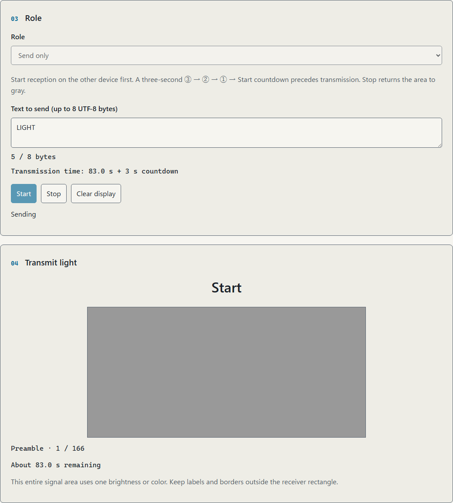
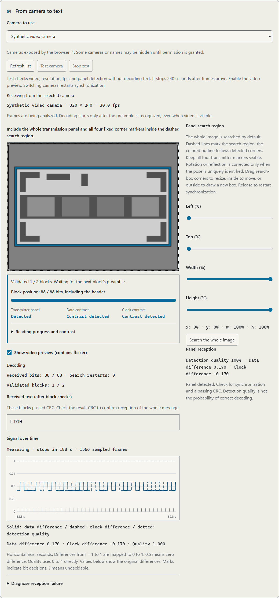
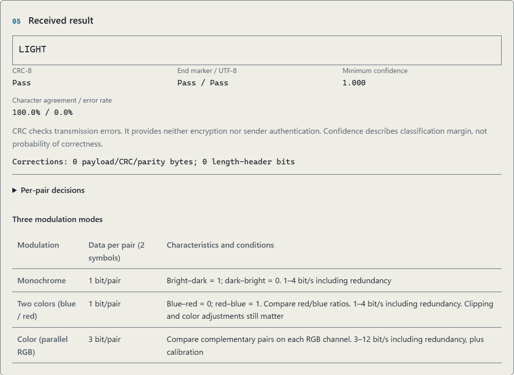
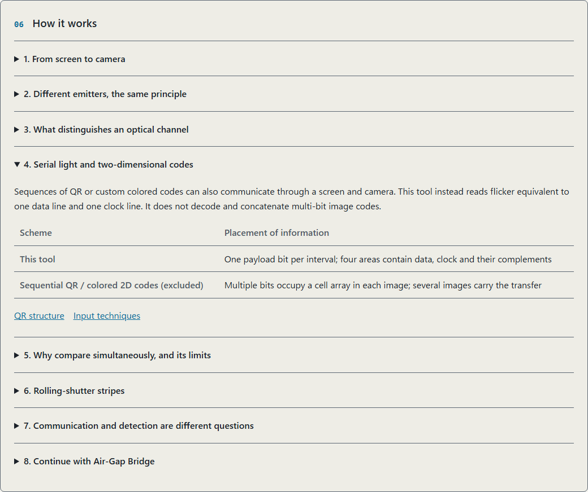

<!--
---
id: day122
slug: photon-flicker-link

title: "Photon Flicker Link"

subtitle_ja: "光で短文を送り、カメラとグラフで通信を観察"
subtitle_en: "Send short text through light and observe the camera signal"

description_ja: "明暗の対と専用クロックで1ビットずつ送り、カメラで最大8バイトの文字列へ復元する教材。時系列グラフ、ブロック訂正、ローカル動画の解析に対応します。"
description_en: "A serial optical link using grayscale pairs and a separate clock, with block correction, camera traces and local video analysis for up to 8 UTF-8 bytes."

category_ja:
  - プライバシー
  - 光学監視
category_en:
  - Privacy
  - Optical Surveillance

difficulty: 2

tags:
  - optical-channel
  - visible-light-communication
  - air-gap
  - camera
  - signal-processing

repo_url: "https://github.com/ipusiron/photon-flicker-link"
demo_url: "https://ipusiron.github.io/photon-flicker-link/"

hub: true
---
-->

# Photon Flicker Link - Send short text through light and visualize the channel


[](https://ipusiron.github.io/photon-flicker-link/)

**Day122 - 200 Security Tools Built with Generative AI**

This educational tool reads screen flicker with a camera and reconstructs short text.
V3 sends one bit at a time using simultaneous grayscale pairs and a separate clock.
The camera view, data and clock traces, and decoded text show how communication succeeds or fails.

English | [日本語](README.md)

## 🌐 Live demo

👉 **[Open Photon Flicker Link](https://ipusiron.github.io/photon-flicker-link/?lang=en)**

No installation is required. Defaults are binary monochrome, 2 symbol/s, low contrast, and a maximum of 8 UTF-8 bytes.

## 📸 Screenshots

> 
>
> *Sending LIGHT with grayscale pairs and a separate clock. Transmission finishes after one packet.*

> 
>
> *A synthetic video arrives through a virtual camera, with text decoded by block. This is not a physical camera photograph.*

> 
>
> *Offline video decoding recovers LIGHT and passes CRC and UTF-8 checks.*

> 
>
> *Eight lessons include tables and links to primary sources.*

## 📖 How to use

Flashing light can trigger photosensitive seizures (PSE) or discomfort. Consider people nearby and stop if you feel unwell. Low speed and low contrast do not guarantee safety. The author does not encourage misuse.

1. Open the demo on two devices and reload both. Use the version with thick L-shaped marks at all four corners. Adjust brightness while watching the receiver and avoid reflections.
2. Choose Receive only on the receiver, press Test camera, and allow camera access. Check the camera name, resolution, sampled fps and video. Enable Show video preview if it is off.
3. If there are multiple cameras, choose one under Camera to use. You can switch during testing. Use Refresh list if a connected camera is missing.
4. During the camera test, fit the whole sending panel, including all four L-shaped corners and the top marks, inside the search area. Check that the detected quadrilateral follows the panel, keep the devices still, then press Start reception.
5. Choose Send only and start with `A`. Transmission begins after ③ → ② → ① → Start. Defaults take 3 seconds of preparation plus 41 seconds of transmission. Start reception first.
6. Watch the data and clock traces and text appearing by block. Check CRC and UTF-8 at the end. Treat text from failed checks as unverified.
7. Use Stop to interrupt, or Clear display to remove the result and measurements.

Selecting Receive only does not start the camera or signal display. Press Start reception and grant permission to begin video, the trace and live decoding. Turning Show video preview off hides only the preview. On wide screens, rectangle controls sit to the right of the video; on narrow screens, they follow the video, live text and trace.

Camera testing checks frame capture without decoding.
Below the video, the receiver distinguishes panel search, synchronization and block reception.
Text appears only after a block passes CRC. At the default rate, the first text takes about 40 seconds for `A` or 52 seconds for the `LIGH` prefix of `LIGHT` from transmission start.
The three-second countdown is additional. The empty text area also shows these examples.

The reception progress bar shows the observed bit position in the current block.
Before synchronization, it stays in preparation; elapsed time alone does not advance it.
After synchronization, it counts the 16 header bits. Once the block length is known, it shows progress through the whole block, including the header.
Unreadable bits still count as observed positions, so this is not a count of recovered characters or a passing CRC.
Remaining time is an estimate from the observed clock period. It appears only during active reception with synchronization, a known block length and a readable clock.
The next block or resynchronization updates the progress reference. Stopping keeps the last position and clears the estimate.

Separate indicators report whether the current data difference and clock difference are sufficient.
They distinguish a missing panel, an unmeasured difference and an insufficient difference, so you can adjust brightness or angle while watching the video.
A sufficient difference does not establish successful bit reception over time or a passing CRC.
Updating video or traces does not mean that text is already verified.

Opening has a 30-second limit; reception lasts at most 240 seconds after the first captured frame.
Stop test, hiding the tab or reaching the deadline releases the camera.
Starting reception during testing uses the same device with a fresh time allowance.
Switching cameras releases the old camera and restarts synchronization and decoding. Camera names and selection are not saved.

Camera lists and names may be incomplete before permission is granted. An empty list alone does not prove that no camera is connected. Testing distinguishes permission denial, no camera, a camera that cannot be opened, and an unavailable selected device. Successful frame capture does not guarantee optical communication.

The public interface offers one grayscale signaling method.
Low contrast uses two gray levels; High uses near-black and near-white levels.
Gray levels can be read when the receiver can distinguish the pair within the same image. Seeing changes by eye alone does not establish successful decoding.
If the reported difference is insufficient, you can try High while watching the receiver. This setting is separate from reducing the device's screen brightness.
Faster rates, high contrast and transmission with reduced motion enabled require confirmation.
There is no full-screen mode or automatic retransmission. Hiding the tab stops the session without automatic resumption.

To inspect a recording on one device, choose Offline decoding and select a video of this tool's transmission. The file must be browser-playable, such as MP4 or WebM, no larger than 128 MiB and no longer than 120 seconds. Character agreement and error rate appear only when you supply the expected text. This is not a general video-to-text extractor. The tool has no recording function.

## ✨ Features and result interpretation

| Item | Behavior |
|---|---|
| Roles | Send only, Receive only, Offline decoding |
| Cameras | List and refresh, device selection, video/resolution/fps test; switching releases the previous camera |
| Data pair | Left dark/right bright = 0; the reverse = 1. Compare within the same camera image |
| Separate clock | The other two bars exchange brightness at every boundary, including repeated data bits |
| Fixed markers | Four L-shaped corners and asymmetric marks establish location and orientation; carry no payload |
| Measurement rectangle | Search area enclosing the entire panel; corner resizing, moving and four sliders |
| Trace | Simultaneous data and clock differences with distinct line styles |
| Reception progress | Observed bit position in the current block, including unreadable positions; separate from CRC success |
| Current contrast | Separate data and clock assessments; detecting a difference does not guarantee decoding |
| Confidence | Brightness difference, noise and agreement across frames; not a probability of correctness |
| `?` | A character containing low-confidence or missing symbols |
| CRC | CRC-8 per block and CRC-16 for the whole message; separate from encryption, authentication and error correction |
| Agreement | Offline with known text only: matching Unicode characters at the same positions divided by the longer character count |
| Environment | Sampling fps, rVFC/rAF, resolution, exposure/WB API reports and estimated period |

Reception does not automatically switch exposure or white balance (WB) to manual mode.
It reports automatic, manual or unsupported settings and compares brightness within the same frame.
Exchanging each pair's levels keeps the panel's average brightness constant.
Clipping and reflections that affect different parts of the panel remain possible.

### V3 preserves one-bit serial communication

V3 is incompatible with V1/V2 transmissions and recordings.
The panel contains two data bars and two clock bars, for four bars in total.
Only one payload bit is sent at each instant, and reconstructing text requires a sequence of observations.
It does not transfer data using QR, animated QR, color codes or a custom two-dimensional barcode.
Fixed markers locate and orient the bars; they do not arrange message bits across a spatial data grid.
The panel differs from V3 before the corner-marker update, so reload both endpoints.

- Repeated values: the clock pair changes even when the data pair stays the same, marking the next bit.
- Brightness changes: compare two bars in the same image, normalized against the fixed frame. Missing contrast is not guessed.
- Short blocks: split the payload into chunks of up to four bytes. Each has synchronization, an index, total length, identity, CRC-8 and two RS parity bytes.
- Correction bounds: extended Hamming(8,4) protects the header. Each block's RS code corrects one erroneous byte or up to two bytes with known missing positions.
- Reception failure: abandon an uncorrectable block and keep searching for synchronization. Retain checked blocks and fill gaps from retransmission of the same content.
- Completion: check block CRC-8, whole-message CRC-16 and UTF-8. A separate unprotected end-color marker does not decide acceptance.

Correction counts and CRC are displayed separately. Live text updates as checked blocks become available.
CRC and identity values can collide, and errors beyond the correction capacity are not all detectable.
See the [wire format and receiver details](docs/protocol-v3.md).

### When reception is unstable

Fit the whole sending panel, including all four L-shaped corners and the top marks, inside the search area.
Showing only some bars is insufficient to locate the panel and its references.
Drag a corner to resize, inside to move or from outside to create a new rectangle.
Releasing applies the search area and restarts synchronization. Sliders provide the same adjustment.

Keep the panel large in the image, nearly front-facing and steady.
Static marks establish the order of the four bars and compensate for rotation, mirroring and perspective.
Missing marks, uncertain orientation, steep angles, very small images and multiple candidates are rejected.
Excessive dimming, clipping, reflections and movement can also cause failure.
Watch the image, panel detection and data/clock differences while adjusting; lowering brightness indefinitely is not a remedy.
The sending panel hides the pointer and does not display an explanatory tooltip over the signal. Keep notifications and other windows from covering its marks or bars.

On iPhone, True Tone, Night Shift and auto-brightness alter display conditions.
For comparison experiments, record the settings and consider temporarily disabling them to hold conditions steady.
See [Apple's instructions](https://support.apple.com/en-us/109351).
The tool does not lock screen brightness or change camera exposure/WB to manual at reception startup.

The owner reported that V2 reached Decoding but failed in monochrome and blue/red when sending from iPhone to PC/Vivaldi.
The first V3 release also failed in both directions. With the corner-marker version, the owner reported receiving the `LIGH` prefix with a passing block CRC on iPhone, sent from a PC at 2 symbol/s with Low contrast.
In that attempt, the sender was restarted several times while reception continued. The receiver reached its 240-second deadline at 62/64 bit positions and 1/2 checked blocks. Full-message success remains unconfirmed.
Exact start times and the physical diagnostic JSON are unavailable, so the cause leading to the deadline is not established. Automated success does not establish full-message success on hardware.

Above the graph, remaining time, sample count and stop reason are shown.
Measurement stops on success or after 240 seconds and keeps the last graph.
After stopping, press Restart reception before sending again. Resynchronization does not extend the deadline.
The 240 seconds include waiting before transmission; restarting only the sender does not renew that deadline.
Adjust the setup in Test camera before starting reception. After a long adjustment, stop and restart reception before the next transmission.

Save reception diagnostic below the graph exports sample times, data/clock measurements and decoder events as local JSON.
It excludes images, audio, camera names, device IDs and video filenames.
Text may be recoverable from samples, so use test text such as `A` before sharing.
Save before retrying: starting again, clearing the display or reloading discards the diagnostic.

## 🔬 Transfer limits and data density

Camera frame rate limits transfer speed. Multiple frames are needed per symbol, and this tool rejects synchronization below 2 frames/symbol. At 30 fps, at most 15 symbol/s is a necessary condition, not a sufficient one. Exposure time, missing frames, display phase, distance, ambient light and automatic exposure/WB can impose stricter limits.

Reading flicker as a temporal channel with a camera gives a design range of a few to tens of bits per second in monochrome.
This implementation offers 2/4/8 symbol/s, with one coded bit per update: 2/4/8 bit/s including redundancy.
These are not limits on fast photodiodes or methods that decode rolling-shutter stripes.

The table gives calculated durations for the maximum eight-byte payload; `mono` means grayscale serial signaling.
Payload throughput is 64 bits divided by total duration, including each block's synchronization, header, identity, CRC, correction and final guard.
The three-second countdown is separate. Actual display intervals can be slightly longer because of browser scheduling.

| Mode | symbol/s | Coded rate (bit/s) | Duration for 8 bytes (s) | Payload throughput (bit/s) |
|---|---:|---:|---:|---:|
| mono | 2 | 2 | 105 | 0.61 |
| mono | 4 | 4 | 52.5 | 1.22 |
| mono | 8 | 8 | 26.25 | 2.44 |

The four bars provide complementary data and clock pairs.
The tool does not add parallel payload cells or place a whole message in one image.
Legacy monochrome, blue/red, RGB and four-level PAM remain in pure-function regression tests only.
The [legacy synthetic comparison](docs/measurements.json) is not a V3 or physical success rate.

## 🔄 Comparison with other air-gap channels

Each study uses different transmitters, receivers and conditions. Distances depend on laboratory conditions, line of sight and specific equipment; they are not performance claims for this tool. `B/s` means bytes per second; `bit/s` means bits per second. Mitigations are examples of restricting a channel, not guarantees of prevention.

| Method | Channel and receiver | Reported throughput | Reported distance | Example restriction and source |
|---|---|---|---|---|
| Photon Flicker Link | Screen → camera | 2–8 bit/s (including redundancy) | Awaiting owner testing | Block light; manage screen/camera placement. Calculated implementation rates |
| LED-it-GO | HDD LED → photodiode / camera | 4000 bit/s / 15–120 bit/s | Optical sensor: 3–5 m indoors, 20 m outdoors at night. Camera: 8 m | Cover LEDs; block line of sight. [Paper](https://arxiv.org/abs/1702.06715) |
| Acoustic (Day120 / ggwave reference) | Speaker → microphone | ggwave: 8–16 B/s. Day120: 1.25–11.08 B/s (calculated for 256 bytes) | ggwave: about 1 m, developer report. Day120: unmeasured | Manage acoustic paths and microphones. [ggwave](https://github.com/ggerganov/ggwave#details), [Day120](https://github.com/ipusiron/airborne-tone-link) |
| MAGNETO / ODINI | CPU magnetic field → phone magnetometer / dedicated sensor | 0.2–5 bit/s / 40 bit/s | 0–12 cm / 100–150 cm | Manage distance and magnetic sensors. [MAGNETO paper](https://arxiv.org/abs/1802.02317); ODINI values are quoted via its table, original paper not checked |
| BitWhisper | Heat → another PC's temperature sensor | 1–8 bit/hour | 0–40 cm, bidirectional | Manage device spacing and temperature changes. [Paper](https://arxiv.org/abs/1503.07919) |
| AirHopper | Video card → phone FM receiver | 13–60 B/s | 1–7 m | Electromagnetic shielding and receiver management. [Research institution](https://cyber.bgu.ac.il/how-leak-sensitive-data-isolated-computer-air-gap-near-mobile-phone-airhopper/) |
| PowerHammer | Power-line current variation → current probe | Line-level: about 1000 bit/s; phase-level: about 10 bit/s | Depends on the electrical tap location | Monitor/filter the power-line channel. [Paper](https://arxiv.org/abs/1804.04014) |

Surveillance cameras can also serve as optical receivers: [aIR-Jumper](https://arxiv.org/abs/1709.05742) studies infrared communication with security cameras. Visible light can cross transparent glass, subject to reflections, tint and coatings. This differs from short-range thermal communication in placement and response time; heat-transfer behavior cannot be reduced to one universal rule.

Line of sight (LOS) and suitable optics can allow distant observation. LED-it-GO's 20 m outdoor night result uses an optical sensor and must be distinguished from its camera result. Light is less directly affected by acoustic noise, but sunlight, 100/120 Hz lighting flicker, reflections and other emitters add optical noise.

## 🎯 Use cases

Ways of using this tool in particular

- Compare `A` (1 byte, 41 s), `LIGHT` (5 bytes, 93 s), and `日本` (6 bytes, 97 s) to explore how byte count and block count affect duration. These calculations use 2 symbol/s and exclude the three-second countdown.
- Observe the separate clock changing while repeated data bits leave the data pair unchanged. The four bars carry one payload bit at each instant.
- Keep the full panel in the measurement rectangle and vary distance or angle while observing detection and brightness differences. Measurements are relative camera values, not readings from a lux meter.
- A puzzle designer can send `LIGHT` and show its reconstruction. A receiver that knows the format can recover it, so this does not protect a secret password.

General learning and creative uses

- At home or in an electronics workshop, participants can divide reception, device positioning and stopping between them, transferring a short message across devices. Obtain the agreement of people nearby and account for flicker sensitivity.
- For preliminary research, receive the same short message under different distances, lighting and devices, and separately record conditions and CRC results. The tool does not automatically save video or results.
- Combine Day120's acoustic channel and Day041's audio-band observations to study how reception conditions differ by medium. Day041 does not measure light signals.

## 🔗 Books and related tools

Use this tool as a practical environment for observing communication paths discussed in the Air-Gap Bridge books. It accompanies these chapter topics without quoting the book text:

- [『エアギャップ・ブリッジ 隔離環境のデータ出力技法』](https://akademeia.info/?page_id=53554) (Japanese-language book): Chapter 2, 「エアギャップとは何か」 (What is an air gap?)
- [『エアギャップ・ブリッジ 隔離環境のデータ入力技法』](https://akademeia.info/?page_id=53563) (Japanese-language book): Chapter 9, 「将来展望」 (Future outlook)
- [Day120 Airborne Tone Link](https://ipusiron.github.io/airborne-tone-link/): short text over sound
- [Day041 Mic Gain Logger](https://ipusiron.github.io/mic-gain-logger/): audio bands and input levels

Lessons also introduce [LED-it-GO](https://arxiv.org/abs/1702.06715), [xLED](https://arxiv.org/abs/1706.01140), [CTRL-ALT-LED](https://arxiv.org/abs/1907.05851) and [aIR-Jumper](https://arxiv.org/abs/1709.05742). They share the principle of encoding data in light but differ in emitter size, wavelength, switching speed and ease of reception. This tool does not control those devices.

## 🔒 Data handling and safeguards

Video frames are processed in a canvas without recording. The selected video's blob URL is released on stop or completion. Text and graph samples remain only in page memory until Clear display or page closure. Only language and theme are stored in localStorage.

Choosing Save reception diagnostic downloads a JSON file containing measurements and decoder events. Nothing is uploaded automatically. A downloaded file remains on the device after the page is cleared.

Analysis makes no external requests. CSP retains `connect-src 'none'`, with `media-src 'self' blob:` for local videos. There are no inline scripts, style attributes or external libraries. Loading the public page and deliberately opening external links are separate network activities.

There is no encryption: a receiver that knows the format can recover the content. A covert channel tries to hide the existence or medium of communication; it does not guarantee content secrecy. This tool's slow flicker is not necessarily inconspicuous.

GitHub Pages does not allow arbitrary HTTP response headers. X-Frame-Options and CSP frame-ancestors cannot be applied through meta tags.

## 🧪 Tests and verification scope

Run with Node.js 22 or later, without installing dependencies:

```sh
npm test
```

Tests cover conversions, CRC, known answers, independent clocks, block correction, panel detection, actual paint intervals and interruption.
They also check dictionaries, CSP, README values and images, while retaining legacy comparisons.
GitHub Actions runs syntax checks and the same tests on push and pull_request.

With an existing Python Playwright and FFmpeg installation, `python -X utf8 test/browser.py` checks HTTP/file UI, virtual cameras, video decoding, rAF, hidden-tab stops and denied permission. Add `--screenshots` to capture README images, or `--url https://ipusiron.github.io/photon-flicker-link/` to check the public page.

The [verification record](docs/verification.md) separates measurements by protocol and lists outstanding checks.
The owner has reported receiving the checked `LIGH` prefix from a PC on an iPhone.
**V3 full-message reception on hardware, distance, ambient light, device variation and effective exposure/WB behavior await owner testing (本人確認待ち).**
The reported V2 iPhone-to-PC/Vivaldi failure has not yet been confirmed resolved on hardware.

## 📁 Directory structure

```text
photon-flicker-link/          # Project
├── .gitattributes           # Text endings and binary PNG rules
├── .gitignore               # Local working data exclusions
├── .github/                 # GitHub configuration
│   └── workflows/           # Automated checks
│       └── test.yml         # Node 22 CI
├── index.html               # Single-page interface and CSP
├── style.css                # Themes and responsive layout
├── theme-init.js            # Theme before the first paint
├── codec-core.js            # Pure encoding, calibration and decoding
├── reliable-codec.js        # V2 paired signaling, correction and clock tracking
├── spatial-codec.js         # V3 separate clock and block decoding
├── optical-panel.js         # Fixed frame and four-bar rendering/detection
├── camera-io.js             # Camera/video lifecycle and sampling
├── screen-tx.js             # Finite screen transmission
├── app.js                   # DOM, traces and roles
├── messages.js              # Bilingual text and eight lessons
├── package.json             # Dependency-free test configuration
├── README.md                # Japanese documentation
├── README.en.md             # English documentation
├── CLAUDE.md                # Development rules
├── LICENSE                  # MIT License
├── assets/                  # Japanese screenshots
│   ├── send.png             # Active transmission
│   ├── receive.png          # Camera and trace
│   ├── result.png           # Decoded result
│   ├── lesson.png           # Lesson
│   └── en/                  # English screenshots
│       ├── send.png         # Active transmission
│       ├── receive.png      # Camera and trace
│       ├── result.png       # Decoded result
│       └── lesson.png       # Lesson
├── docs/                    # Verification material
│   ├── measurements.json    # Synthetic comparison
│   ├── protocol-v2.md       # V2 wire format and decision rules
│   ├── protocol-v3.md       # V3 serial signaling and block format
│   └── verification.md      # Results and physical-test checklist
└── test/                    # Automated verification
    ├── codec.test.js        # Pure functions and synthetic conditions
    ├── reliable.test.js     # V2 known answers, gaps, clocks and gain changes
    ├── spatial.test.js      # V3 synchronization, blocks, retries and rejection
    ├── marker-camera.test.js # Independent perspective, blur, reflection and decoding fixtures
    ├── panel.test.js        # Panel position, gain, cropping and angle
    ├── channel.test.js      # Rendering through simulated capture and decoding
    ├── io.test.js           # IO lifecycle and interruption
    ├── structure.test.js    # HTML, CSP, dictionaries and contrast
    ├── readme.test.js       # Values, metadata, images and structure
    ├── theme-init.test.js   # Initial theme and load position
    └── browser.py           # Browser and virtual-camera checks
```

## 💻 Requirements

A browser with JavaScript and Canvas is required. The sending, lesson and offline-decoding UI works when opening `index.html` directly. Use HTTPS or localhost for camera access and grant browser permission. For local HTTP, run `python -m http.server 8000 --bind 127.0.0.1`.

The tool uses video-frame timestamps with rVFC when available, otherwise rAF sampling.
If live mediaTime stops advancing while presented frames increase, it uses capture or presentation time anchored on the same frame.
rAF timestamps and fps are estimates and do not guarantee rVFC precision.
Camera, codec and exposure/WB support depend on the device. The owner has reported block reception on iPhone, but full-message reception and comparisons with documented OS/browser versions remain unconfirmed.

## 📄 License

- Source: MIT License; see [LICENSE](LICENSE).
- Runtime and npm development dependencies: none.
- Screenshots: this tool's interface with synthetic inputs.

## 🛠️ About this tool

This tool is part of the 200 Security Tools Built with Generative AI project. The project creates and publishes security-related tools over 100 days with AI assistance.

[Project information and other tools](https://akademeia.info/?page_id=44607)
