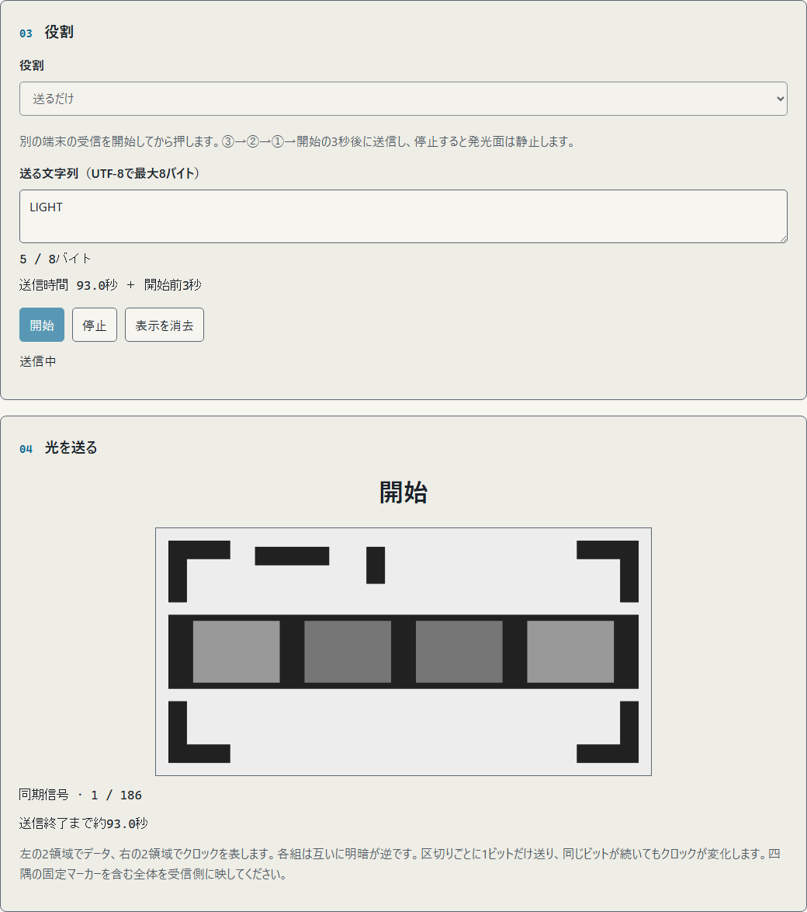
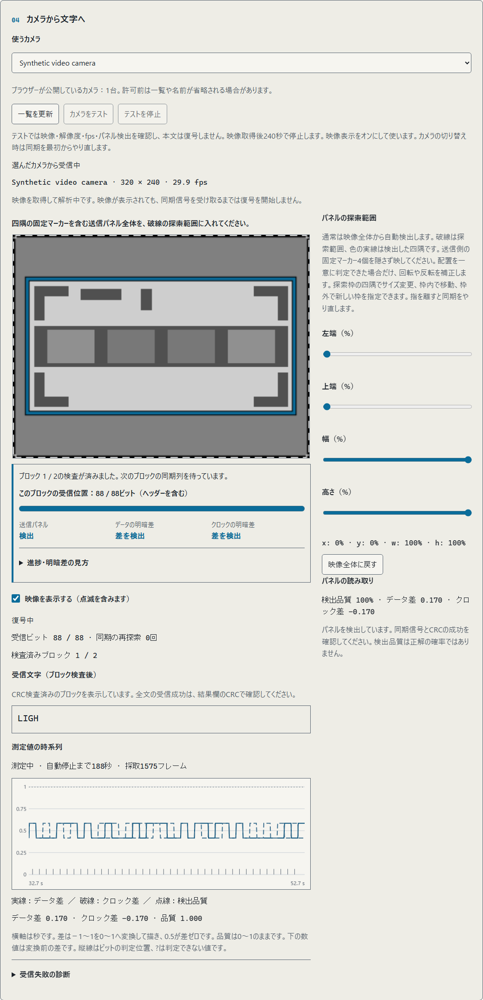
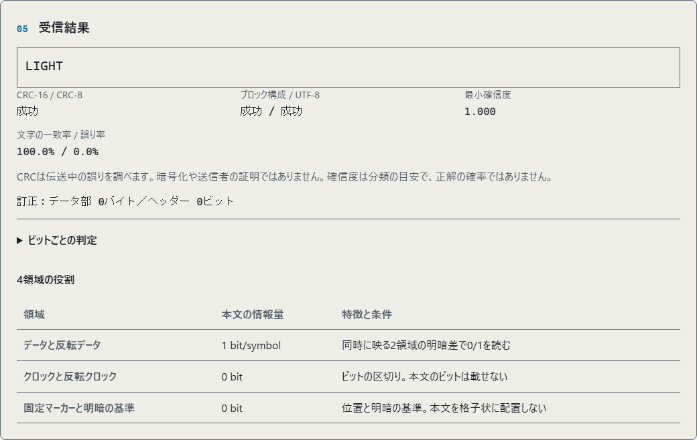
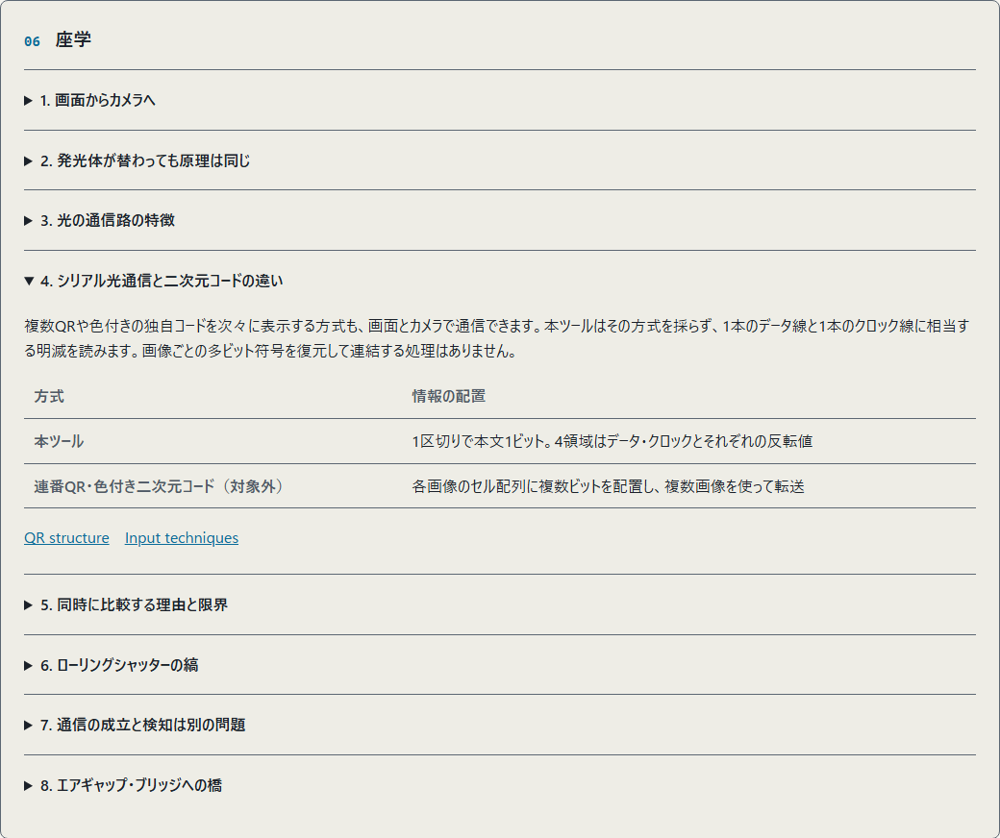

<!--
---
id: day122
slug: photon-flicker-link

title: "Photon Flicker Link"

subtitle_ja: "光で短文を送り、カメラとグラフで通信を観察"
subtitle_en: "Send short text through light and observe the camera signal"

description_ja: "明暗の対と専用クロックで1ビットずつ送り、カメラで最大8バイトの文字列へ復元する教材。時系列グラフ、ブロック訂正、ローカル動画の解析に対応します。"
description_en: "A serial optical link using grayscale pairs and a separate clock, with block correction, camera traces and local video analysis for up to 8 UTF-8 bytes."

category_ja:
  - プライバシー
  - 光学監視
category_en:
  - Privacy
  - Optical Surveillance

difficulty: 2

tags:
  - optical-channel
  - visible-light-communication
  - air-gap
  - camera
  - signal-processing

repo_url: "https://github.com/ipusiron/photon-flicker-link"
demo_url: "https://ipusiron.github.io/photon-flicker-link/"

hub: true
---
-->

# Photon Flicker Link - 光で短文を送り、通信路を可視化


[](https://ipusiron.github.io/photon-flicker-link/)

**Day122 - 生成AIで作るセキュリティツール200**

画面の明滅をカメラで読み取り、短い文字列へ戻す教材です。
v3は明暗を同時に表示する対と、区切りを示す専用クロックで、1ビットずつ順番に送ります。
映像、データとクロックのグラフ、復号結果を並べ、通信の成立と失敗を観察できます。

[English](README.en.md) | 日本語

## 🌐 デモページ

👉 **[Photon Flicker Linkを開く](https://ipusiron.github.io/photon-flicker-link/)**

インストール不要です。初期設定はモノクロ2値・2 symbol/s・低コントラスト、本文はUTF-8で最大8バイトです。

## 📸 スクリーンショット

> 
>
> *「LIGHT」を明暗の対と専用クロックで送信中。送信は1回で終了します。*

> 
>
> *合成動画を仮想カメラから受信し、ブロック単位で復号した状態です。実機撮影ではありません。*

> 
>
> *オフライン動画から「LIGHT」を復元し、CRCとUTF-8の検査が成功した状態です。*

> 
>
> *8節の座学に表と一次資料へのリンクを掲載しています。*

## 📖 使い方

点滅は光過敏性発作（PSE）や体調不良の原因になり得ます。周囲の人にも配慮し、不調を感じたら停止してください。低速・低コントラストでも安全を保証するものではありません。作者は悪用を勧めません。

1. 2台でデモを開き、送受信の両側で再読み込みする。四隅に太いL字の目印がある版を使う。受信映像を見ながら明るさを調整し、反射を避ける。
2. 受信側を「受けるだけ」にし、「カメラをテスト」を押してカメラを許可する。名前、解像度、取得fpsと映像を確認する。プレビューがオフなら「映像を表示する」をオンにする。
3. カメラが複数ある場合は「使うカメラ」で選ぶ。テスト中にも切り替えられる。接続したカメラが見つからなければ「一覧を更新」を押す。
4. 受信側で「受信開始」を押す。四隅のL字と上部の目印を含む送信パネル全体を、受信映像の探索範囲に入れる。検出した四角形がパネルに重なることを確認し、端末を固定する。
5. 送信側を「送るだけ」にし、まず`A`を入力して開始する。③→②→①→開始の後に送信する。初期設定で準備3秒＋送信41秒。受信側を先に開始する。
6. データとクロックのグラフ、ブロック単位のライブ文字を観察する。最後にCRCとUTF-8を確認する。不成功の文字列は未確認として扱う。
7. 「停止」で中断する。「表示を消去」で結果と測定値を消す。

「受けるだけ」を選んだ時点ではカメラも信号の表示も始まりません。「受信開始」を押して許可すると映像・グラフ・ライブ復号を開始します。「映像を表示する」がオフなら映像だけを隠します。広い画面では探索範囲の調整欄が映像の右側にあり、狭い画面では映像・ライブ復号・グラフの後に並びます。

カメラテストでは復号せず、映像が取得できるかを確認します。
映像の下にパネル探索・同期待ち・ブロック受信の段階を表示します。
文字はCRC検査済みブロックごとに表示するため、初期設定では送信開始から最初の文字まで、`A`で約40秒、`LIGHT`の先頭`LIGH`で約52秒かかります。
カウントダウン3秒は別です。文字欄にもこの目安を表示します。

受信の進捗バーは、現在のブロックで取得したビットの位置を示します。
同期前は準備中となり、時間の経過だけでは進みません。
同期後はヘッダーの16ビットを数え、長さが判明するとヘッダーを含むブロック全体の進捗へ切り替わります。
判別できなかったビットも取得位置に数えるため、進捗は復元済みの文字数やCRC成功を表しません。
残り時間は受信したクロックの周期から求めた概算です。同期とブロック長が判明し、クロックを読める受信中だけ表示します。
次のブロックや再同期では進捗の基準を更新し、停止すると最後の位置を残して概算を消します。

データの差とクロックの差は個別に「現在の差は足りる／不足」と表示します。
パネル未検出、差の未測定、差の不足を区別し、映像を見ながら明るさや角度を調整できます。
差が足りても、時間順のビット取得やCRC検査が成功したとは限りません。
映像やグラフの更新と、文字の確定は同時ではありません。

カメラを開く待ち時間は最大30秒、最初のフレームを採取してからの受信は最大240秒です。
「テストを停止」、タブの非表示、時間切れでカメラを解放します。
テスト中の「受信開始」は同じ機器で受信を始め、時間を数え直します。
受信中のカメラ変更では前のカメラを停止し、同期と復号を最初からやり直します。
カメラ名や選択した機器は保存しません。

カメラの一覧と名前は、許可前には省略される場合があります。空の一覧だけでは未接続と断定できません。テストで許可拒否、カメラなし、使用中、選んだ機器の利用不可を分けて表示します。映像の取得を確認できても、光通信の成功を保証するものではありません。

公開UIの方式はグレースケール1種類です。
明暗差の「低」は灰色2段階、「高」は黒・白に近い2段階です。
灰色でも受信側が同じ画像内の差を判別できれば読み取れますが、肉眼で変化が見えるだけでは復号の成功は判断できません。
差が不足する場合は受信側の表示を確認しながら「高」を試せます。端末の画面輝度を下げる操作とは別の設定です。
速い設定、高コントラスト、動きを減らす設定での送信には確認ダイアログがあります。
全画面表示や自動再送はありません。タブが隠れると停止し、自動再開しません。

1台で確認する場合は「オフライン復号」で、本ツールの送信を記録した動画を選びます。ブラウザーで再生できるMP4・WebMなど、128MiB以下・120秒以下が対象です。正解の文字列を入力した場合に限り、文字の一致率と誤り率を表示します。一般の動画から文章を抽出する機能ではありません。本ツールには録画機能がありません。

## ✨ 機能と判定の読み方

| 項目 | 内容 |
|---|---|
| 役割 | 送るだけ／受けるだけ／オフライン復号の3種類 |
| カメラ | 一覧と更新、機器の選択、映像と解像度・fpsのテスト。切り替え時は旧カメラを解放 |
| データの対 | 左の帯が暗く右が明るいと0、逆なら1。同じ画像内の差を読む |
| 専用クロック | 残り2本の帯が区切りごとに明暗を交換。同じデータの連続でも区切りを検出 |
| 固定マーカー | 四隅のL字と非対称な目印で位置・姿勢を判定。本文のデータを格納しない |
| 探索範囲 | パネル全体を囲む探索範囲。四隅のドラッグ、移動、4本のスライダーで指定 |
| グラフ | 同時に採取したデータの差とクロックの差。線種でも区別 |
| 受信進捗 | 現在のブロックで取得したビット位置。判別不能も含み、CRC成功とは別 |
| 現在の明暗差 | データとクロックを個別に判定。差の検出だけでは復号成功を保証しない |
| 確信度 | 明暗差、雑音、フレーム間の一致から得る目安。正解の確率ではない |
| `?` | 確信度不足、または取得できなかったシンボルを含む文字 |
| CRC | 各ブロックにCRC-8、全体にCRC-16。暗号化、送信者認証、誤り訂正とは別 |
| 一致率 | オフラインで正解があるときだけ、同じ位置のUnicode文字の一致数÷長い方の文字数 |
| 環境表示 | 採取fps、rVFC/rAF、解像度、露出とWBのAPI報告、推定周期 |

受信開始時に露出やホワイトバランス（WB）を自動で手動固定しません。
カメラが報告した自動、手動、非対応の状態を表示し、同じフレーム内の明暗差を読みます。
対の明暗を交換してパネルの平均値を保ちますが、白飛びや空間的に異なる反射まで除去できるわけではありません。

### 時系列の1ビット通信を保つv3

v3はv1/v2の送信や録画と互換性がありません。
画面にはデータ用の2本とクロック用の2本、合計4本の帯を並べます。
1つの時刻に本文の1ビットだけを送り、文字列の復元には連続した観測が必要です。
QR、連続QR、カラーコード、独自の2次元バーコードによるデータ転送は行いません。
固定マーカーは帯の位置と姿勢を見つけるために使い、空間方向へ本文を並べません。
四隅マーカーを追加する前のv3とはパネルの形が異なるため、送受信の両端で再読み込みしてください。

- 同じ値の連続：データが同じ明暗でも専用クロックが反転し、次のビットを区別する。
- 明るさの変化：同じ画像内の2本を比較し、固定枠の基準で補正する。必要な差がない場合は推測で埋めない。
- 短いブロック：本文を最大4バイトずつ分割し、各ブロックに同期、番号、全長、識別情報、CRC-8、RSの2バイト冗長を付ける。
- 訂正範囲：ヘッダーは拡張Hamming(8,4)。RSはブロックごとに1バイトの誤り、または位置がわかる2バイトまでの欠落を訂正する。
- 受信失敗：訂正不能なブロックを打ち切り、受信中も次の同期を探す。検査済みの別ブロックは保持し、同じ内容の再送から不足分を補える。
- 完了判定：ブロックのCRC-8、全体のCRC-16、UTF-8を検査する。終端の色だけで成功を取り消す方式は使わない。

訂正数とCRCを別々に表示します。ライブ文字は検査済みのブロックがそろうと更新します。
CRCと識別情報には衝突があり、訂正能力を超える誤りをすべて検出できるわけではありません。
[符号と受信処理の詳細](docs/protocol-v3.md)を参照してください。

### 受信が安定しないとき

探索範囲には、四隅のL字と上部の目印を含む送信パネル全体を入れてください。
4本の帯の一部だけを入れても、位置と基準値を取得できません。
四隅のドラッグで拡大縮小、内側で移動、外側からのドラッグで新規作成できます。
指を離した時点で探索範囲を変更し、同期をやり直します。スライダーでも調整できます。

パネルを大きく写し、正面に近い角度で固定してください。
静止した目印から4本の順序を判定し、回転・左右反転と遠近変形を補正します。
目印の欠け、判別できない姿勢、強い傾き、小さすぎる像、複数の候補は読めないものとして扱います。
暗すぎる画面、白飛び、反射、手ぶれでも失敗します。明るさを下げ続ければ改善するわけではありません。
受信映像と、パネルの検出状態、データとクロックの差を見ながら調整してください。

iPhoneのTrue Tone、Night Shift、明るさの自動調節は表示条件を変えます。
比較実験では設定を記録し、一時的にオフにして条件をそろえる方法があります。
操作は[Appleの公式説明](https://support.apple.com/en-us/109351)を参照してください。
本ツールは画面輝度を固定せず、受信開始時にカメラの露出やWBを手動へ変更しません。

v2では、iPhoneからPC/Vivaldiへの送信が、モノクロと青赤の両方で「復号中になるが成功しない」と報告されています。
v3でも、iPhoneブラウザーとPCブラウザーの両方向で文字が出ず、自動検出できないとの報告がありました。
実機の採取値がなく、その原因は未特定です。今回の四隅マーカー版で解決するかは本人確認待ちです。
自動検証の成功を、この実機問題の解決確認として扱いません。

グラフの上に、残り時間、採取数、停止理由を表示します。
受信成功または240秒で測定を停止し、最後のグラフを残します。
停止後は「受信を再開」を押してから送信してください。再同期だけでは時間を延長しません。

失敗時は、グラフ下の「受信診断を保存」で時刻、データとクロックの測定値、判定経過をJSONへ保存できます。
画像、音声、カメラ名、機器ID、動画名は含めません。
測定値から本文を復元できる場合があるため、共有時は`A`などのテスト文字を使ってください。
次の開始、表示の消去、再読み込みで診断が消えるため、再試行の前に保存します。

## 🔬 転送速度の限界と密度

カメラのフレームレートが速度を制限します。1シンボルに複数のフレームが必要で、本ツールは同期時に2 frame/symbol未満を拒否します。30fpsならシンボルレート15 symbol/s以下が必要条件であり、十分条件ではありません。露出時間、フレーム欠落、画面更新との位相差、距離、環境光、露出・WBの自動調整でさらに条件が厳しくなります。

カメラで明滅を時系列として読む方式は、モノクロで数bps〜数十bps級の設計になります。
本実装は2/4/8 symbol/sを選べ、各更新で1ビットを送るため、冗長部を含む符号ビット速度も2/4/8 bit/sです。
高速フォトダイオードやローリングシャッターの縞を読む方式の限界を表すものではありません。

次表は最大8バイトを送る計算値です。`mono`はグレースケールの時系列通信を指します。
実効速度は本文64ビット÷送信時間で、各ブロックの同期、ヘッダー、識別情報、CRC、誤り訂正と最後のガードを含みます。
開始前3秒は別です。実際の描画間隔はブラウザーの更新時刻によって少し長くなります。

| モード | symbol/s | 符号ビット速度(bit/s) | 8バイトの時間(s) | 本文の実効速度(bit/s) |
|---|---:|---:|---:|---:|
| mono | 2 | 2 | 105 | 0.61 |
| mono | 4 | 4 | 52.5 | 1.22 |
| mono | 8 | 8 | 26.25 | 2.44 |

4本の帯は、データとクロックをそれぞれ対にして読むためのものです。
帯を増やして本文を並列に配置したり、画像1枚へ文章を格納したりはしません。
旧モノクロ、青赤、RGB、4段PAMは純関数の回帰検査に残し、公開UIからは選びません。
[旧方式の合成比較値](docs/measurements.json)をv3の性能や実機成功率として扱わないでください。

## 🔄 他のエアギャップ通信との比較

研究ごとに送受信機と条件が異なります。距離は実験室条件・直視・特定機材などに依存し、本ツールの性能を示しません。`B/s`はバイト/秒、`bit/s`はビット/秒です。対策欄は経路を制限する例であり、それだけで防止を保証しません。

| 方式 | 経路・受信機 | 報告された帯域 | 報告された距離 | 経路を制限する例・出典 |
|---|---|---|---|---|
| Photon Flicker Link | 画面→カメラ | 2〜8 bit/s（冗長部を含む） | 本人確認待ち | 遮光・画面とカメラの配置管理。本実装の計算値 |
| LED-it-GO | HDD LED→フォトダイオード／カメラ | 4000 bit/s／15〜120 bit/s | 光センサー：室内3〜5m・夜間屋外20m。カメラ：8m | LEDの遮光・視線の遮断。[論文](https://arxiv.org/abs/1702.06715) |
| 音響（Day120 / ggwave参考） | スピーカー→マイク | ggwave：8〜16 B/s。Day120：1.25〜11.08 B/s（256バイト計算値） | ggwave：約1m（開発者談）。Day120：未測定 | 音響経路・マイクの管理。[ggwave](https://github.com/ggerganov/ggwave#details)・[Day120](https://github.com/ipusiron/airborne-tone-link) |
| MAGNETO / ODINI | CPU磁界→スマホ磁力計／専用磁気センサー | 0.2〜5 bit/s／40 bit/s | 0〜12cm／100〜150cm | 距離・磁気センサーの管理。[MAGNETO論文](https://arxiv.org/abs/1802.02317)。ODINI値は同論文の表経由、原論文未確認 |
| BitWhisper | 発熱→別のPCの温度センサー | 1〜8 bit/hour | 0〜40cm、双方向 | 端末間隔・温度変化の管理。[論文](https://arxiv.org/abs/1503.07919) |
| AirHopper | ビデオカード→FM受信携帯 | 13〜60 B/s | 1〜7m | 電磁遮蔽・受信機の管理。[研究機関](https://cyber.bgu.ac.il/how-leak-sensitive-data-isolated-computer-air-gap-near-mobile-phone-airhopper/) |
| PowerHammer | 電力線の電流変動→電流プローブ | line-level：約1000 bit/s、phase-level：約10 bit/s | 配電線のタップ位置に依存 | 電力線側の監視・フィルター。[論文](https://arxiv.org/abs/1804.04014) |

光では監視カメラを受信機にする研究もあります。[aIR-Jumper](https://arxiv.org/abs/1709.05742)は赤外線と監視カメラの例です。可視光を透過するガラスならガラス越しの受光が可能ですが、反射・着色・遮光膜の影響を受けます。近接熱通信とは必要な配置や応答時間が異なり、熱の伝わり方を一律に扱うことはできません。

見通し（LOS）と光学系を確保すると望遠で離れた発光体を観察できます。ただしLED-it-GOの夜間屋外20mは光センサーの値で、カメラの値と分けて読む必要があります。光は音響ノイズの直接の影響を受けにくい一方、太陽光・照明の100/120Hzフリッカー・反射・別の発光が雑音になります。

## 🎯 ユースケース

このツールならではの使い方

- 情報教育の授業で、`A`（1バイト・41秒）、`LIGHT`（5バイト・93秒）、`日本`（6バイト・97秒）を比較し、バイト数とブロック数が所要時間に与える差を調べる。2 symbol/sでの計算値で、開始前3秒は別である。
- 通信設計の学習で、同じ値が続いてもデータの帯とは別にクロックが反転する様子を観察する。4本の帯で運ぶ本文は、各時刻に1ビットである。
- 撮像条件の実験で、パネル全体を探索範囲に収め、距離や角度を変えて検出状態と明暗差を観察する。測定値はカメラ画像の相対値で、照度計の代用ではない。
- 謎解きの制作者が、短い合図`LIGHT`を送って復号過程を見せる。暗号化がないため、方式を知る人は復元でき、秘密の合言葉の保護にはならない。

一般的な学習・制作での利用

- 家庭や工作会で、受信開始、端末の固定、停止を分担し、離れた端末に文字を渡す実験を行う。周囲の人の同意と点滅への配慮が必要である。
- 研究の予備実験で、同じ短文を距離・照明・端末を変えて受信し、条件とCRC結果を別途記録する。本ツールは動画や受信結果を自動保存しない。
- Day120の音響経路、Day041の音の帯域観察と組み合わせ、媒体ごとに受信条件が異なることを学ぶ。光の信号をDay041で測ることはできない。

## 🔗 書籍・関連ツール

本ツールは『エアギャップ・ブリッジ』で扱う通信経路を、自分で観察するための実習環境です。次の章の案内と併せて利用できます。

- [『エアギャップ・ブリッジ 隔離環境のデータ出力技法』](https://akademeia.info/?page_id=53554)：第2章「エアギャップとは何か」
- [『エアギャップ・ブリッジ 隔離環境のデータ入力技法』](https://akademeia.info/?page_id=53563)：第9章「将来展望」
- [Day120 Airborne Tone Link](https://ipusiron.github.io/airborne-tone-link/)：音で短文を渡す教材
- [Day041 Mic Gain Logger](https://ipusiron.github.io/mic-gain-logger/)：音の帯域や入力レベルの観察

座学では[LED-it-GO](https://arxiv.org/abs/1702.06715)、[xLED](https://arxiv.org/abs/1706.01140)、[CTRL-ALT-LED](https://arxiv.org/abs/1907.05851)、[aIR-Jumper](https://arxiv.org/abs/1709.05742)も案内します。発光を情報に変える原理は共通ですが、発光体の大きさ、波長、駆動速度、受光のしやすさは異なります。本ツールはこれらの機器を制御しません。

## 🔒 データと安全対策

映像はフレームごとにcanvasで処理し、録画しません。選んだ動画のblob URLは停止・完了時に解放します。文字列・グラフはページ内のメモリーにだけ残り、「表示を消去」またはページを閉じると消えます。localStorageに保存するのは言語と明暗だけです。

「受信診断を保存」を押した場合だけ、測定値と判定経過をJSONファイルとしてダウンロードします。自動アップロードはありません。ダウンロードしたファイルはページの消去後も端末内に残ります。

アプリの解析処理は外部通信を行いません。CSPは`connect-src 'none'`を維持し、ローカル動画用に`media-src 'self' blob:`を指定しています。インラインスクリプト・style属性・外部ライブラリーを使いません。公開ページの初回取得と、自分で開いた外部リンクの通信は別です。

暗号化がないため、方式を知る受信者は内容を復元できます。covert channelが隠そうとするのは通信の存在や媒体であり、内容の秘匿を保証するものではありません。本ツールの低速の点滅も、人に気づかれないとは限りません。

GitHub Pagesでは任意のHTTPヘッダーを設定できず、X-Frame-OptionsとCSPのframe-ancestorsはmetaでは適用できません。

## 🧪 テストと検証範囲

Node.js 22以上で、依存パッケージを追加せず実行できます。

```sh
npm test
```

変換、CRC、既知解答、独立クロック、ブロック訂正、パネル検出、実描画間隔、中断処理、日英辞書、CSP、READMEの数値と画像を検査します。
旧方式の比較試験も維持します。GitHub Actionsはpushとpull_requestで構文検査と同じテストを実行します。

既存のPython PlaywrightとFFmpegがある開発環境では、`python -X utf8 test/browser.py`でHTTP/fileのUI、仮想カメラ、動画、rAF、非表示停止、権限拒否を検査できます。`--screenshots`でREADME画像を撮影し、`--url https://ipusiron.github.io/photon-flicker-link/`で公開ページを検査します。

[公開用検証記録](docs/verification.md)に、方式ごとの採取値と未確認項目を記載しています。
**v3の2台間通信、距離、環境光、端末差、露出とWBの実効は本人確認待ちです。**
v2で報告されたiPhoneからPC/Vivaldiへの受信失敗は、実機での解決確認が済んでいません。

## 📁 ディレクトリー構造

```text
photon-flicker-link/          # プロジェクト
├── .gitattributes           # テキスト改行とPNGの扱い
├── .gitignore               # 作業用データの除外
├── .github/                 # GitHub設定
│   └── workflows/           # 自動検証
│       └── test.yml         # Node 22のCI
├── index.html               # 1枚の画面とCSP
├── style.css                # 明暗・レスポンシブ表示
├── codec-core.js            # 符号化・較正・同期復調の純関数
├── reliable-codec.js        # v2の反転送信・誤り訂正・同期追従
├── spatial-codec.js         # v3の独立クロックとブロック復号
├── optical-panel.js         # 四隅マーカーと4本の帯の描画・検出
├── camera-io.js             # カメラ・動画・フレーム採取
├── screen-tx.js             # 有限回の画面送信
├── app.js                   # DOM・グラフ・役割の制御
├── messages.js              # 日英文言と8節の座学
├── package.json             # 依存なしのテスト設定
├── README.md                # 日本語の説明
├── README.en.md             # 英語の説明
├── CLAUDE.md                # 開発時の規則
├── LICENSE                  # MIT License
├── assets/                  # 日本語の画面画像
│   ├── send.png             # 送信中
│   ├── receive.png          # カメラと時系列
│   ├── result.png           # 復号結果
│   ├── lesson.png           # 座学
│   └── en/                  # 英語の画面画像
│       ├── send.png         # 送信中
│       ├── receive.png      # カメラと時系列
│       ├── result.png       # 復号結果
│       └── lesson.png       # 座学
├── docs/                    # 検証資料
│   ├── measurements.json    # 合成条件の比較値
│   ├── protocol-v2.md       # v2の符号と判定の仕様
│   ├── protocol-v3.md       # v3の時系列通信とブロック仕様
│   └── verification.md      # 検証結果と本人確認項目
└── test/                    # 自動検証
    ├── codec.test.js        # 純関数と合成条件
    ├── reliable.test.js     # v2の既知解答・欠落・時計・明るさ
    ├── spatial.test.js      # v3の同期・ブロック・再送・拒否
    ├── marker-camera.test.js # 独立画像の遠近変形・ぼけ・反転と復号
    ├── panel.test.js        # パネルの位置・光量・欠け・傾き
    ├── channel.test.js      # 描画から模擬撮像と復号までの経路
    ├── io.test.js           # 入出力の寿命と中断
    ├── structure.test.js    # HTML・CSP・日英・配色
    ├── readme.test.js       # 数値・メタデータ・画像・構成
    └── browser.py           # ブラウザーと仮想カメラの検証
```

## 💻 動作環境

JavaScriptとCanvasを使うブラウザーが必要です。送信・座学・オフライン復号のUIは`index.html`を直接開いても動作します。カメラはHTTPSまたはlocalhostで利用し、ブラウザーの許可が必要です。ローカルHTTPは`python -m http.server 8000 --bind 127.0.0.1`で起動できます。

rVFCがあれば動画フレームの時刻を使い、なければrAFで採取します。
提示フレーム数が進んでもライブ映像のmediaTimeが止まる場合は、同一フレームで対応づけた撮像時刻または提示時刻を使います。
rAFの時刻とfpsは近似値で、rVFCと同じ精度を保証しません。
機器、コーデック、露出とWBの対応状況は端末ごとに異なります。Safari実機は未検証です。

## 📄 ライセンス

- ソースコード：MIT License。詳細は[LICENSE](LICENSE)を参照
- 実行時・npm開発依存：なし
- スクリーンショット：本ツールの画面と合成入力を使用

## 🛠️ このツールについて

本ツールは、「生成AIで作るセキュリティツール200」プロジェクトの一環として開発されました。このプロジェクトでは、AIの支援を活用しながら、セキュリティに関連するさまざまなツールを100日間にわたり制作・公開していく取り組みを行っています。

[プロジェクトの詳細と他のツール](https://akademeia.info/?page_id=44607)
